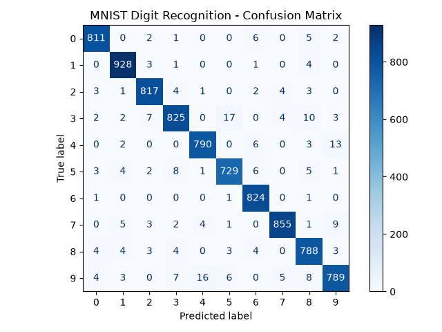

# Task-2-MNIST-Handwritten-Digit-Recognition-Arch-Technologies
MNIST Handwritten Digit Recognition Arch Technologies

# MNIST Handwritten Digit Recognition

A machine learning project that recognizes handwritten digits from **0 to 9** using a trained TensorFlow/Keras model and the Kaggle MNIST Digit Recognizer dataset. The project includes data preprocessing, model training, evaluation, prediction, and a Streamlit web application.

## Project Overview

Handwritten digit recognition is an image classification task. The model learns patterns from labeled digit images and predicts the digit represented in a new image.

This project was developed as a beginner machine learning assignment using Python and PyCharm.

## Objectives

- Load and preprocess handwritten digit data.
- Train a machine learning model to classify digits from 0 to 9.
- Evaluate model performance using accuracy and a confusion matrix.
- Save the trained model for reuse.
- Build a web app that lets users upload a handwritten digit image.
- Deploy the app online using Streamlit Community Cloud.

## Dataset

**Source:** Kaggle Digit Recognizer  
https://www.kaggle.com/competitions/digit-recognizer/data

The Kaggle training CSV contains 42,000 labeled examples. Each example has:

- `label`: the correct digit, from 0 to 9.
- `pixel0` to `pixel783`: 784 pixel features representing a 28 × 28 grayscale image.

Pixel values are originally between 0 and 255. During preprocessing, they are normalized to the range 0–1.

> The Kaggle competition's separate `test.csv` does not contain labels. This project evaluates the model using a held-out split from the labeled training data.

## Technologies Used

- Python
- TensorFlow / Keras
- NumPy
- Pandas
- Matplotlib
- Scikit-learn
- Pillow
- Streamlit
- PyCharm

## Project Structure

```text
task1MNIST_Digit_Recognition/
│
├── dataset/
│   └── train.csv
│
├── models/
│   ├── mnist_model.keras
│   ├── accuracy_graph.png
│   ├── confusion_matrix.png
│   └── sample_predictions.png
│
├── train_model.py
├── predict_digit.py
├── main.py
├── app.py
├── requirements.txt
└── README.md
```

*The files listed under `models/` are based on the project files shown in PyCharm. If your actual filenames differ, update this structure accordingly.*

## How the Model Works

1. **Load data:** Read the labeled Kaggle CSV.
2. **Separate inputs and labels:** Use the pixel columns as input features and `label` as the target.
3. **Preprocess:** Convert pixel values to numeric data and normalize them to 0–1.
4. **Split the data:** Create training and testing subsets.
5. **Train:** Fit a TensorFlow/Keras neural network to learn digit patterns.
6. **Evaluate:** Compare model predictions with true test labels.
7. **Save:** Store the trained model as `models/mnist_model.keras`.
8. **Predict:** Load the saved model and predict a digit for a new image.

The Streamlit application preprocesses uploaded images to a 28 × 28 grayscale format and sends them to the trained model.

## Installation

### 1. Clone the repository

```bash
git clone https://github.com/YOUR_USERNAME/YOUR_REPOSITORY.git
cd YOUR_REPOSITORY
```

Replace `YOUR_USERNAME` and `YOUR_REPOSITORY` with your GitHub details.

### 2. Create and activate a virtual environment (optional)

On Windows:

```bash
python -m venv .venv
.venv\Scripts\activate
```

### 3. Install dependencies

```bash
python -m pip install -r requirements.txt
```

Your `requirements.txt` should include the packages required by your scripts and app. For example:

```text
tensorflow
numpy
pandas
scikit-learn
matplotlib
streamlit
pillow
```

For reproducible results, use dependency versions compatible with the TensorFlow version used to train and save your model.

## Train the Model

If the dataset is available locally, run:

```bash
python train_model.py
```

The training script should preprocess the data, train the model, evaluate it, and save the trained model in the `models/` directory.

**Note:** If the repository only includes the saved model, you can run the web app without retraining. The dataset and training script are needed to reproduce training.

## Run the Digit Prediction Script

If your project includes `predict_digit.py`, run it with:

```bash
python predict_digit.py
```

Check the script for any image path or input requirements it expects.

## Run the Streamlit Web App

Start the app with:

```bash
python -m streamlit run app.py
```

Then open the local address shown in the terminal. Streamlit commonly uses:

http://localhost:8501

The app allows a user to upload an image of a handwritten digit and view the model's prediction.

## Model Evaluation

The project evaluates the trained model using metrics such as:

- **Accuracy:** fraction of test examples classified correctly.
- **Confusion matrix:** shows which digits are correctly or incorrectly classified.
- **Sample predictions:** visual comparison of actual and predicted digit labels.

### Results

| Evaluation item | Result |
|---|---|
| Model architecture | [Enter your actual model type, e.g. CNN or dense neural network] |
| Test accuracy | [Enter actual accuracy from your training output] |
| Evaluation data | Held-out test split from labeled Kaggle training data |
| Saved model | `models/mnist_model.keras` |

Do not enter an estimated accuracy. Use the value printed by your training program.

## Deployment

This Streamlit app can be deployed using **Streamlit Community Cloud**.

1. Upload `app.py`, `requirements.txt`, and `models/mnist_model.keras` to a GitHub repository.
2. Open https://share.streamlit.io/
3. Connect your GitHub account.
4. Select your repository and the `app.py` entry point.
5. Deploy the application.
6. Test the published app using a few digit images.

**Live app:** [Add your deployed Streamlit URL here]

The deployment needs a compatible TensorFlow version and the saved model file. Do not upload your virtual environment folder.

## Screenshots

Add your project screenshots here after capturing them:

- Dataset preview
- Training output and actual accuracy
- Accuracy graph
- Confusion matrix
- Sample predictions
- Streamlit app prediction screen
- Deployed application

Example Markdown for adding an image stored in the repository:

```markdown

```

## Limitations

- The model may misclassify handwriting that differs from the training examples.
- Uploaded images may need better cropping, centering, and background preprocessing.
- The evaluation score on the held-out Kaggle data may not represent performance on every real-world image.
- The model's exact architecture and accuracy depend on the training code and settings used.

## Future Improvements

- Improve uploaded-image cropping and centering.
- Add a drawing canvas so users can write digits directly in the app.
- Compare different neural network architectures.
- Test the model on more handwriting styles.
- Improve the user interface and add more evaluation visualizations.

## Learning Outcomes

Through this project, I practiced:

- Working with image datasets.
- Preprocessing pixel-based data.
- Training a classification model.
- Evaluating machine learning performance.
- Saving and loading a trained Keras model.
- Building a Streamlit application.
- Preparing a model for online deployment.

## References

- Kaggle Digit Recognizer: https://www.kaggle.com/competitions/digit-recognizer/data
- TensorFlow: https://www.tensorflow.org/
- Keras: https://keras.io/
- Scikit-learn: https://scikit-learn.org/
- Streamlit: https://docs.streamlit.io/

---

**Project type:** Machine Learning Assignment  
**Task:** Handwritten Digit Recognition  
**Classes:** 0–9  
**Saved model:** `models/mnist_model.keras`

## Model Demo Link:https://task-2-mnist-handwritten-digit-recognition-arch-technologies-d.streamlit.app/
